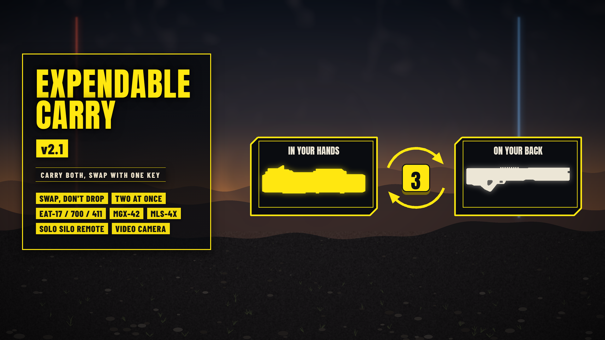

# Expendable Carry

*Pick up an EAT and keep your support weapon on your back.*

**Download:** `Expendable-Carry-1.2.0.zip` from the [latest release](https://github.com/Th3chef/Expendable-Carry/releases/latest) (not the source code). Needs [Bingus Shared Loader](https://www.nexusmods.com/helldivers2/mods/16292) v19 or newer.

## What it does

In the base game you have one support weapon slot. Pick up an EAT, or any other expendable, and the game drops your Railgun, Autocannon or machine gun on the ground, and you have to go back for it.

With this mod your support weapon goes onto your back instead, and the expendable goes in your hands. When you're done with the expendable, press your support weapon key and your weapon is back in your hands.

It's for using an expendable **for a moment** without losing your weapon. It is not a second support weapon slot or a backpack: you carry one extra item, and switching back drops the expendable (unless you tick the **Swap, Don't Drop** option, below).

## How to use it

1. **Pick up an expendable** (EAT-17, EAT-700, EAT-411 Leveller, MGX-42 Bullet Storm, MLS-4X Commando, or the Solo Silo's targeting remote). Your support weapon goes onto your back, where the game holsters it, and the expendable is in your hands.
2. **Fire it.** When it's used up, your support weapon goes back to your support slot. It stays on your back until you draw it with your support weapon key, like any holstered weapon.
3. **Or switch back early:** press your support weapon key (3 by default). The expendable is dropped at your feet, and you can pick it up again later. Your weapon is back in your hands, with its own weapon-switch sound.

## Good to know

- **One at a time:** switching back drops the expendable; it doesn't stay with you. To use it again, pick it back up. (With **Swap, Don't Drop**, the key swaps the two instead.)
- **Switching weapons:** switch to your primary or secondary with the expendable in hand and the expendable is dropped; your support weapon stays on your back. A grenade or stratagem throw keeps the expendable. (With **Swap, Don't Drop**, switching keeps it on your back.)
- **Your own key:** the mod uses your support weapon key from the game's controls, so a key you changed works too. Typing it in the chat doesn't swap.
- **Controllers:** a controller has no support weapon button, so tap your switch weapon button (Y / Triangle by default) with the expendable in hand. Holding it for the weapon wheel doesn't swap.
- **Another weapon out:** if your primary or secondary is out when you pick up an expendable, the expendable goes into your hands. (With **Swap, Don't Drop**, it stays on your back until you press your support weapon key.)
- **Two expendables, no support weapon (new in 1.1):** if you don't carry a support weapon of your own, say you run the Solo Silo and EATs, the expendable you're holding is carried the same way when you pick up a second one. The Solo Silo's remote goes on its own spot on your belt.
- **Any support weapon:** every weapon that sits in the support slot can be carried.
- **No range limit:** your weapon goes with you, and comes back wherever you are.
- **Safe while carried:** solo and when you host, nobody can pick your carried weapon up, players without the mod included.
- **Light:** it sleeps on the ship, in the menus and whenever nothing is in your support slot (one quick look 4 times a second), and costs a few hundredths of a millisecond a frame while it works.

## Multiplayer

- **Solo and hosting:** everything above. Nobody else needs the mod.
- **Joined games (someone else hosts):** the host's game owns your weapon once it's dropped, so it stays where it was dropped instead of going on your back. Your support weapon key still asks for it back from wherever you are, with the game's pickup animation. The host doesn't need the mod. Other players see it on their minimap, and a squadmate could pick it up (the mod then lets it go).

## Options

**Expendable Carry (required)** is the mod itself: keep it ticked.

**Swap, Don't Drop** (off unless you tick it): your support weapon key swaps what's in your hands and what's on your back, instead of dropping the expendable.

- Two items at most: your support weapon and one expendable, or two expendables with no support weapon of your own. Pick up a third and the one on your back is set down.
- Pick up a support weapon with an expendable in your hands: the expendable goes on your back and your own support weapon there is set down. With two expendables, the one on your back stays and the one in your hands is dropped.
- Switching to your primary or secondary keeps the expendable on your back, and an expendable you pick up with another weapon out stays on your back too; press your support weapon key to draw it.
- Joined games: the item you swap away stays where the host's game set it down, and the key asks the host for it back each time.
- With CowboyBingus's Mod Options Menu installed, it's also a toggle in the game's options (MODS tab, EXPENDABLE CARRY).

## Requirements

[Bingus Shared Loader](https://www.nexusmods.com/helldivers2/mods/16292) v19 or newer.

## Install / update

1. Install [Bingus Shared Loader](https://www.nexusmods.com/helldivers2/mods/16292) v19 or newer if you don't have it.
2. Mod manager (Arsenal / HD2 Mod Manager): add `Expendable-Carry-1.2.0.zip` and enable it. Tick **Expendable Carry (required)** (and **Swap, Don't Drop** if you want it), then **Purge** and **Deploy**.
3. Updating from 1.1: the mod now has options, so make sure **Expendable Carry (required)** is ticked.

## Uninstall

Disable it in your mod manager, then Purge and Deploy. Its log files stay in the Bingus logs folder and can be deleted.

## Compatibility

- A Bingus Shared Loader script: it doesn't replace any game files, so it works alongside other mods.
- Patch-proof by design: it finds what it needs in the game's code by itself after a game update. If something can't be found, it turns itself off (or just that part, like the switch sound) and says so in its log, rather than guessing.
- Made and tested on the October 2026 game version.

## Known limitations

- If you holster the expendable while carrying, the two can share one spot on your back. (With **Swap, Don't Drop**, the carried item moves to your other back spot while both are on your back.)
- With your own support weapon already on your back, a second expendable replaces the first, as in the base game.
- The TX-41 Sterilizer has no weapon-switch sound in the game, so it comes back without one.

## How it works

A Bingus Shared Loader Lua addon.
- **Swap, Don't Drop:** the key gives back the item on your back the same way, and the one the game sets down for it is locked and put on your back in its turn. Its mod manager option only sets a flag the mod reads at start-up.
- When you pick up an expendable, the game sets your support weapon down as usual. The mod locks it (its pickup does nothing for anyone, and its prompt is off) and has the game attach it to your helldiver's holster spot with the same attach the game uses for every holstered weapon.
- Your support weapon key with the expendable in hand: the weapon is unlocked and the game's own routines put it back in your support slot (which drops the expendable) and switch to it, the same calls the game makes when you pick a weapon up, minus the pickup itself.
- Your key comes from the game's control settings file (Steam Cloud), read a few seconds after your helldiver appears and checked again every 15 seconds while you hold a support weapon, so a key you change in the game's options counts within about 15 seconds.
- The game's addresses are found by searching the game's code at start-up.

## Troubleshooting

- Your weapon doesn't go on your back: check Bingus Shared Loader v19 or newer is installed, the mod is enabled, and that you Purged and Deployed after installing.
- Attach the logs to a bug report: *ExpendableCarry.log*, *ExpendableCarry.research.log* and *BingusSharedLoader.log* in `%LOCALAPPDATA%\CowboyBingus\Helldivers2\Logs` (type %LOCALAPPDATA% into the File Explorer address bar and press Enter). ExpendableCarry.log shows whether it found what it needs in the game's code, your support weapon key, and every carry and swap.

## Building from source

See [src/BUILDING.md](src/BUILDING.md).

## Support

If you like my mods, you can support me on [Patreon](https://www.patreon.com/c/Chefboiardee).

## Credits

- **CowboyBingus**: Bingus Shared Loader.
- Fonts: Anton and Barlow Condensed (SIL Open Font License).

## License

All rights reserved. See [LICENSE](LICENSE).
